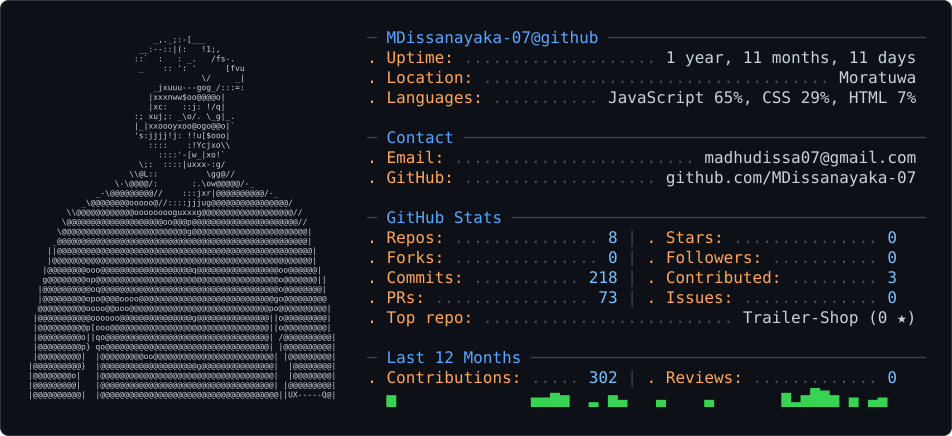

<!-- ASCII Profile Card (Terminal Dashboard) -->
<picture>
  <source media="(prefers-color-scheme: dark)" srcset="dark_mode.svg" />
  <source media="(prefers-color-scheme: light)" srcset="light_mode.svg" />
  
</picture>

  

<!-- Profile Avatar -->

# Hi 👋, I'm Madhuwantha Dissanayaka

<!-- Animated Typing Subtitle -->

  

<!-- Social Connect Badges -->

---

## 👨‍💻 About Me

- 🎓 **Undergraduate Student** based in Moratuwa, Sri Lanka 🇱🇰
- 💻 Passionate about **Full Stack Development** & modern software engineering
- 🐍 Love crafting robust applications and clean code with **Python** & **JavaScript/TypeScript**
- 🌱 Actively building and learning with **React**, **Next.js**, **Node.js**, and **System Architecture**
- 🚀 Experienced in developing web applications, desktop POS systems, and AI-assisted educational platforms
- ⚡ **Fun Fact:** I enjoy exploring new tech stacks and solving real-world challenges through code!

---

## 🛠️ Tech Stack & Skills

### 💻 Programming Languages

  

### 🌐 Frameworks & Runtimes

  

### 🧰 Tools & Platforms

  

---

---

## 🚀 Featured Projects

| Project | Description | Tech Stack |
| :--- | :--- | :--- |
| 📚 **[lms-physics-app](https://github.com/MDissanayaka-07/lms-physics-app)** | Advanced Level Physics LMS featuring AI-driven assistance, interactive quizzes, and student performance analytics. | JavaScript, HTML, CSS |
| 📦 **[WarehousePOS](https://github.com/MDissanayaka-07)** | Desktop-based warehouse and POS management system for inventory, sales, suppliers, employees, and billing analytics. | C#, .NET |
| 🎲 **[SmartCube](https://github.com/MDissanayaka-07/SmartCube)** | Interactive embedded hardware and software system. | C |
| ☕ **[CoffeeShop](https://github.com/MDissanayaka-07/CoffeeShop)** | Web application designed for coffee shop management and online order workflows. | JavaScript, Web Stack |

---

  
⭐️ Designed & Maintained by <a href="https://github.com/MDissanayaka-07"><b>Madhuwantha Dissanayaka</b></a>

